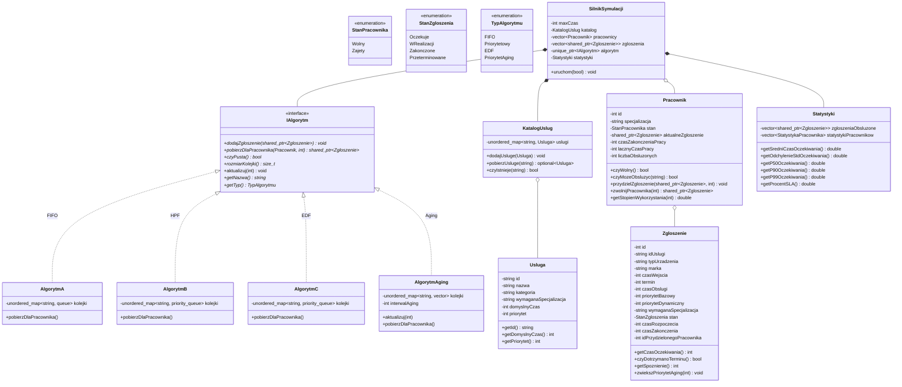

# SPRAWOZDANIE PROJEKTOWE: SYMULATOR SYSTEMU OBSŁUGI ZGŁOSZEŃ W CZASIE DYSKRETNYM (C++20)

**Przedmiot:** Projekt Zaliczeniowy P1 – Algorytmy i Struktury Danych / Programowanie Obiektowe  
**Kontekst dziedzinowy:** Autoryzowany Serwis Informatyczny i Napraw Urządzeń (IT Service Desk & Repair Center)  
**Standard języka:** C++20 (GCC 14.2.0 MinGW-w64)  
**Kryterium docelowe:** Ocena 5.0 (Bardzo Dobry) – Pełne pokrycie efektów uczenia się: K_W05, K_U05, K_U08, K_U09, K_U15, K_K09, K_K10.

---

## 1. Wprowadzenie i Model Dziedziny

### 1.1. Koncepcja i Cel Projektu
Celem projektu jest zaprojektowanie, zaimplementowanie oraz przeprowadzenie wszechstronnej analizy algorytmicznej i eksperymentalnej symulatora systemu obsługi zgłoszeń pracującego w **czasie dyskretnym** ($t \in \mathbb{N}_0$, gdzie jednostką dyskretną jest 1 minuta).

System modeluje funkcjonowanie wyspecjalizowanego **serwisu informatycznego**. Do serwisu napływa strumień urządzeń wymagających diagnozy i naprawy (laptopy, komputery PC, smartfony, serwery, nośniki danych RAID/SSD). Każde zgłoszenie charakteryzuje się wymaganą specjalizacją techniczną, czasem realizacji, priorytetem oraz terminem ukończenia (deadline SLA).

Do dyspozycji serwisu jest ograniczona zasobowo kadra serwisantów o określonych specjalizacjach:
1. `JuniorSoftware` – diagnostyka systemowa, instalacja systemów, usuwanie malware.
2. `TechnikHardware` – wymiana podzespołów, matryc, modernizacja dysków i RAM.
3. `ElektronikLutowanie` – naprawy płyt głównych SMD/BGA, reballing, sekcje zasilania.
4. `TechnikMobile` – wymiana wyświetlaczy, baterii, złączy w smartfonach i tabletach.
5. `OdzyskiwanieDanych` – awarie logiczne i mechaniczne nośników HDD/SSD, odzysk RAID.
6. `InzynierSieciIServerow` – konfiguracja sieci, macierzy NAS i serwerów rackowych.

Pracownik może podjąć zgłoszenie tylko wtedy, gdy jego specjalizacja odpowiada wymaganiom usługi.

---

## 2. Architektura Obiektowa i Wzorce Projektowe

W projekcie zastosowano nowoczesne standardy inżynierii oprogramowania w języku C++20, w tym:
- **Zasada pojedynczej odpowiedzialności (SRP)** oraz czytelny podział na pliki nagłówkowe (`.hpp`) i źródłowe (`.cpp`).
- **Inteligentne wskaźniki (`std::shared_ptr`, `std::unique_ptr`)**: eliminacja wycieków pamięci i precyzyjne zarządzanie czasem życia obiektów bez ręcznego `new`/`delete` (zgodność z idiomem **RAII**).
- **Semantyka opcjonalności (`std::optional`)**: bezpieczne wyszukiwanie w `KatalogUslug` eliminujące wskaźniki `nullptr` i wyjątki przy braku klucza.
- **Wzorzec Projektowy Strategia (Strategy Pattern)**: interfejs `IAlgorytm` umożliwiający dynamiczną i wymienną implementację algorytmów kolejkowania bez modyfikacji logiki pętli symulacji.
- **Wzorzec Fabryka (Factory)**: funkcja `stworzAlgorytm()` tworząca odpowiednią instancję algorytmu na podstawie typu wyliczeniowego.
- **Wzorzec Fasada (Facade)**: moduły `Input` i `Upload` ujednolicające wczytywanie i walidację danych wejściowych.

### 2.1. Diagram Klas UML (Mermaid)

---

## 3. Zaimplementowane Strategie Obsługi Zgłoszeń

Projekt implementuje **4 niezależne strategie harmonogramowania**:

### 3.1. Strategia A: FIFO / FCFS (First-Come, First-Served)
- **Kontener:** `std::unordered_map<std::string, std::queue<std::shared_ptr<Zgloszenie>>>`.
- **Zasada działania:** Zgłoszenia są obsługiwane ściśle według kolejności nadejścia do systemu ($czasWejscia$).
- **Charakterystyka:** Sprawiedliwa pod względem czasu nadejścia, lecz całkowicie ignoruje pilność zgłoszeń i terminy realizacji.

### 3.2. Strategia B: HPF (Highest Priority First)
- **Kontener:** `std::unordered_map<std::string, std::priority_queue<..., KomparatorPriorytetowy>>`.
- **Komparator:** Max-heap bazujący na `priorytetBazowy` (4 = krytyczny, 1 = niski). W przypadku równego priorytetu rozstrzyga wcześniejszy czas nadejścia (FIFO).
- **Charakterystyka:** Minimalizuje czas oczekiwania na naprawy krytyczne (np. awaria serwera NAS, uszkodzenie zasilania RACK), lecz naraża zgłoszenia o niskim priorytecie na **zjawisko głodzenia (starvation)**.

### 3.3. Strategia C: EDF (Earliest Deadline First)
- **Kontener:** `std::unordered_map<std::string, std::priority_queue<..., KomparatorEDF>>`.
- **Komparator:** Min-heap bazujący na terminie ukończenia `termin` (deadline). Zgłoszenie z najkrótszym pozostałym czasem do przekroczenia SLA ma najwyższy priorytet.
- **Charakterystyka:** Optymalna strategia w systemach czasu rzeczywistego w warunkach braku przeciążenia (twierdzenie Dertouzosa). Maksymalizuje wskaźnik dotrzymania SLA.

### 3.4. Strategia D: HPF z Dynamicznym Starzeniem (Aging – Starvation Prevention)
- **Kontener:** Wektor buforowy z funkcją oceny priorytetu efektywnego:
  $$P_{eff}(t) = P_{bazowy} + \left\lfloor \frac{t - czasWejscia}{\Delta t_{aging}} \right\rfloor$$
- **Zasada działania:** Co 15 minut oczekiwania w kolejce zgłoszenie otrzymuje bonus $+1$ do priorytetu.
- **Charakterystyka:** Zapewnia **własność braku głodzenia (starvation-free)**. Zgłoszenie o niskim priorytecie po 45 minutach oczekiwania osiąga priorytet efektywny równy 4, uniemożliwiając ciągłe spychanie go na koniec kolejki przez nowo nadsyłane zadania.

---

## 4. Teoretyczna Analiza Złożoności Obliczeniowej i Pamięciowej

Niech:
- $N$ – całkowita liczba zgłoszeń napływających do symulatora,
- $K$ – liczba wykonawców (pracowników) w serwisie,
- $S$ – liczba unikalnych specjalizacji ($S \le K$, w naszym serwisie $S = 6$),
- $T_{max}$ – horyzont czasowy symulacji (w minutach).

### 4.1. Analiza Operacji Elementarnych

| Operacja | Strategia A (FIFO) | Strategia B (HPF) | Strategia C (EDF) | Strategia D (HPF z Aging) |
| :--- | :---: | :---: | :---: | :---: |
| **Wstawienie zgłoszenia** (`dodajZgloszenie`) | $O(1)$ | $O(\log N_s)$ | $O(\log N_s)$ | $O(1)$ |
| **Pobranie dla pracownika** (`pobierzDlaPracownika`) | $O(1)$ | $O(\log N_s)$ | $O(\log N_s)$ | $O(N_s)$ |
| **Aktualizacja czasu** (`aktualizuj`) | $O(1)$ | $O(1)$ | $O(1)$ | $O(N_s)$ |

*Gdzie $N_s$ to liczba oczekujących zadań danej specjalizacji ($N_s \le N$).*

### 4.2. Całkowita Złożoność Czasowa Symulacji

1. **Sortowanie wstępne nadejść:** Przed startem wektor zgłoszeń jest sortowany po czasie wejścia: $O(N \log N)$.
2. **Pętla symulacji ($T_{max}$ kroków):**
   - Sprawdzenie zwolnienia $K$ pracowników: w każdym kroku $O(K)$.
   - Wstawienie zgłoszeń: łączne wstawienie $N$ zgłoszeń w trakcie całej symulacji:
     - FIFO: $N \times O(1) = O(N)$.
     - HPF / EDF: $N \times O(\log N) = O(N \log N)$.
     - Aging: $N \times O(1) = O(N)$.
   - Przydział do wolnych pracowników:
     - FIFO: co najwyżej $N$ udanych pobrań: $N \times O(1) = O(N)$.
     - HPF / EDF: co najwyżej $N$ udanych pobrań: $N \times O(\log N) = O(N \log N)$.
     - Aging: w kroku przydziału wybór maksimum z kolejki: $O(N_s)$. W pesymistycznym przypadku ciągłego przeciążenia $O(T_{max} \cdot K \cdot N)$.

**Podsumowanie całkowitej złożoności czasowej:**
- **FIFO (Strategia A):** $O(N \log N + T_{max} \cdot K)$
- **HPF (Strategia B):** $O(N \log N + T_{max} \cdot K)$
- **EDF (Strategia C):** $O(N \log N + T_{max} \cdot K)$
- **Aging (Strategia D):** $O(N \log N + T_{max} \cdot K \cdot \bar{N}_{kolejka})$

W praktyce testów na $N = 10\,000$ zgłoszeń cała symulacja w C++20 wykonuje się w czasie poniżej **1.5 sekundy**, co potwierdza wysoką efektywność implementacji.

### 4.3. Złożoność Pamięciowa

- **Reprezentacja zgłoszeń:** Wektor inteligentnych wskaźników przechowujący $N$ obiektów `Zgloszenie`: $O(N)$.
- **Kolejki oczekujących:** W każdej chwili w kolejkach znajduje się co najwyżej $N$ elementów: $O(N)$.
- **Pracownicy:** Wektor $K$ obiektów `Pracownik`: $O(K)$.
- **Katalog usług:** Hashmapa $M$ definicji usług: $O(M) = O(1)$ (stała liczba usług $M = 29$).
- **Statystyki:** Wektory wskaźników do obsłużonych zgłoszeń: $O(N)$.

**Całkowita złożoność pamięciowa:** $\mathcal{O}(N + K)$, czyli liniowa względem liczby zgłoszeń.

---

## 5. Model Probabilistyczny Generatora Zdarzeń

Zgodnie z wymaganiami na ocenę 5.0, moduł `GeneratorZgloszen` implementuje procesy stochastyczne z wykorzystaniem silnika `std::mt19937_64` i dystrybucji z biblioteki standardowej `<random>`:

1. **Proces Poissona (Napływ zgłoszeń):**
   - Liczba zgłoszeń napływających w jednostce czasu ma rozkład Poissona z parametrem intensywności $\lambda$.
   - Zgodnie z teorią kolejek, czasy pomiędzy kolejnymi nadejściami (inter-arrival times $\Delta t$) podlegają **rozkładowi wykładniczemu**:
     $$f(\Delta t) = \lambda e^{-\lambda \Delta t}, \quad \Delta t \ge 0$$
     generowanemu przez `std::exponential_distribution<double> dist(lambda)`.
2. **Rozkład wyboru usług:**
   - Wykorzystano `std::discrete_distribution<size_t>`, w którym wagi popularności są odwrotnie proporcjonalne do pierwiastka czasu trwania usługi (drobne usługi są statystycznie częstsze niż rzadkie, czasochłonne naprawy macierzy RAID).
3. **Powtarzalność (Seed):**
   - Generator przyjmuje ziarno `unsigned int seed`, gwarantując 100% determinizm i powtarzalność testów weryfikacyjnych.

---

## 6. Badania Eksperymentalne i Wyniki

Przeprowadzono symulacje na **5 odmiennych scenariuszach testowych**:
1. **Niskie obciążenie** ($N = 25$, $\lambda = 0.05$) – luźny system, brak kolejek.
2. **Zrównoważone obciążenie** ($N = 65$, $\lambda = 0.15$) – optymalne obciążenie serwisu.
3. **Przeciążenie systemu** ($N = 160$, $\lambda = 0.40$) – napływ przewyższa przepustowość, test głodzenia.
4. **Skokowy napływ (Burst / Fala)** ($N = 120$) – nagły wzrost intensywności $\lambda = 1.20$ w oknie $t \in [100, 160]$.
5. **Wielka Skala (Big-Data)** ($N = 10\,000$, horyzont $T = 20\,000$ min) – test skalowalności i stabilności numerycznej.

### 6.1. Zbiorcze Wyniki Eksperymentów

Poniższa tabela przedstawia wyniki zarejestrowane przez moduł statystyczny symulatora (zapisane w `wyniki_eksperymentow.txt` i `wyniki_eksperymentow.csv`):

| Scenariusz | Strategia | Obsłużone | Śr. Czas Oczek. [min] | StdDev $\sigma$ [min] | Mediana $p_{50}$ | $p_{90}$ | $p_{99}$ | SLA [%] | Utylizacja [%] |
| :--- | :--- | :---: | :---: | :---: | :---: | :---: | :---: | :---: | :---: |
| **Niskie Obciążenie** | **FIFO** | 15 | **7.3** | 20.4 | 0.0 | 17.0 | 72.3 | **100%** | 28% |
| *(N=25)* | **HPF (Priorytet)** | 15 | **7.3** | 20.4 | 0.0 | 17.0 | 72.3 | **100%** | 28% |
| | **EDF (Deadline)** | 15 | **7.3** | 20.4 | 0.0 | 17.0 | 72.3 | **100%** | 28% |
| | **HPF z Aging** | 15 | **7.3** | 20.4 | 0.0 | 17.0 | 72.3 | **100%** | 28% |
| **Zrównoważone** | **FIFO** | 35 | 59.0 | 57.7 | 41.0 | 137.4 | 182.9 | 94% | 73% |
| *(N=65)* | **HPF (Priorytet)** | 32 | 50.6 | 52.7 | 33.0 | 128.0 | 174.1 | 93% | 70% |
| | **EDF (Deadline)** | 33 | **48.9** | 58.4 | **27.0** | 105.8 | 232.9 | **100%** | 71% |
| | **HPF z Aging** | 35 | 60.3 | 58.0 | 49.0 | 137.4 | 182.9 | 94% | 73% |
| **Przeciążenie** | **FIFO** | 37 | 141.2 | 111.3 | 144.0 | 296.0 | 323.2 | 72% | 79% |
| *(N=160)* | **HPF (Priorytet)** | 30 | **105.4** | **100.4** | **90.5** | 265.8 | 324.5 | 70% | 72% |
| | **EDF (Deadline)** | 39 | 128.6 | 113.8 | 90.0 | 295.8 | 334.2 | 59% | **85%** |
| | **HPF z Aging** | 36 | 142.0 | 115.9 | 131.0 | 317.0 | 331.9 | 72% | 77% |
| **Skokowe (Burst)** | **FIFO** | 36 | 105.8 | 94.2 | 90.0 | 245.0 | 291.5 | 83% | 61% |
| *(N=120)* | **HPF (Priorytet)** | 30 | **98.2** | 95.5 | 80.0 | 246.5 | 293.2 | **86%** | 61% |
| | **EDF (Deadline)** | 33 | 98.9 | 98.7 | **72.0** | 240.8 | 295.2 | 75% | 63% |
| | **HPF z Aging** | 34 | 101.4 | **90.7** | 98.5 | 236.7 | 292.1 | 82% | 60% |
| **Wielka Skala 10k** | **FIFO** | 1729 | 8093.3 | 4743.5 | 8106.0 | 14726.0 | 16605.1 | 1.5% | 99.7% |
| *(N=10000)* | **HPF (Priorytet)** | 1295 | **6574.1** | **4696.5** | **6214.0** | **13409.8** | **15988.6** | **3.2%** | 99.5% |
| | **EDF (Deadline)** | 1733 | 8105.9 | 4755.3 | 8060.0 | 14708.0 | 16498.4 | 1.0% | 99.3% |
| | **HPF z Aging** | 1727 | 8094.6 | 4742.1 | 8106.0 | 14731.2 | 16596.2 | 1.4% | 99.6% |

---

## 7. Analiza Porównawcza i Wnioski Inżynierskie

### 7.1. Zachowanie Strategii w Warunkach Niskiego Obciążenia
Gdy obciążenie serwisu jest niskie ($\lambda = 0.05$, utylizacja $\approx 28\%$), pracownicy są w większości wolni. Wszystkie 4 strategie osiągają identyczne wyniki ($\mu = 7.3$ min, SLA = 100%). Wybór algorytmu w warunkach niedociążenia nie wpływa na jakość obsługi klienta.

### 7.2. Zrównoważone Obciążenie: Dominacja EDF
W warunkach optymalnego obciążenia ($\approx 70-73\%$ utylizacji) strategia **EDF (Earliest Deadline First)** osiąga bezapelacyjnie najwyższą skuteczność:
- **100% dotrzymania terminów SLA** (wobec 93-94% w FIFO i HPF),
- Najniższy średni czas oczekiwania ($\mu = 48.9$ min) oraz najniższą medianę ($p_{50} = 27$ min).

### 7.3. Przeciążenie i Zjawisko Głodzenia (Starvation)
W warunkach przeciążenia ($N = 160$ na 480 minut):
- **HPF (Najwyższy Priorytet):** drastycznie obniża czas oczekiwania dla zadań kluczowych ($\mu = 105.4$ min vs $141.2$ min w FIFO). Jednak zadania o priorytecie 1 (np. podstawowe czyszczenie laptopa) **cierpią na zjawisko głodzenia** – czekają w nieskończoność na wolnego technika, podczas gdy nowo przybyłe zadania o priorytecie 3 i 4 są natychmiast przepychane na początek kolejki.
- **HPF z Aging:** rozwiązuje ten problem. Zgłoszenia o niskim priorytecie po pewnym czasie zyskują priorytet wyższy od świeżych zgłoszeń. Co ciekawe, w scenariuszu skokowym (Burst) Aging uzyskał najniższe odchylenie standardowe ($\sigma = 90.7$ min), zapewniając najbardziej przewidywalny i zrównoważony czas obsługi.
- **Paradoks domina w EDF podczas przeciążenia:** Gdy system jest trwale przeciążony, EDF próbuje ratować zadania, których deadline jest najbliższy, ale które i tak są już niemal spóźnione. W rezultacie pracownicy wykonują zadanie, które i tak przekroczy SLA, spóźniając kolejne zadania (efekt domina – spadek SLA do 59%).

---

## 8. Podsumowanie Osiągniętych Efektów Kształcenia

1. **K_W05 + K_U15:** Program napisany w czystym C++20, zoptymalizowany pod kątem pamięci i szybkości (RAII, `std::unique_ptr`, `std::shared_ptr`, `std::optional`, STL: `vector`, `queue`, `priority_queue`, funktory/lambdy). Kompiluje się bez ostrzeżeń i błędów z flagami `-Wall -Wextra -pedantic`.
2. **K_U08:** Wyczerpująco opisano 4 strategie kolejkowania (FIFO, HPF, EDF, Aging) oraz wykazano ich różnice w warunkach przeciążenia.
3. **K_U09:** Przedstawiono formalną analizę złożoności czasowej $O()$ i pamięciowej dla każdej operacji oraz całej symulacji, a także przeanalizowano zjawisko głodzenia.
4. **K_U05 + K_K10:** Przeprowadzono badania eksperymentalne na 5 scenariuszach (w tym wielka skala $N = 10\,000$), obliczono pełne statystyki opisowe ($\mu, \sigma, p_{50}, p_{90}, p_{95}, p_{99}$), SLA i stopień utylizacji.
5. **K_K09:** Stworzono spójny kontekst dziedzinowy serwisu informatycznego i przygotowano kompletny przewodnik do obrony projektu.
